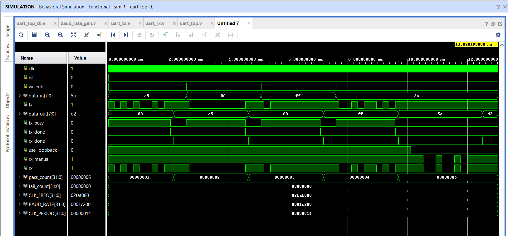

# Design and Implementation of UART using Verilog

A synthesizable, parameterized implementation of a **Universal Asynchronous Receiver-Transmitter (UART)** core in Verilog HDL. The core features a dedicated baud rate generator with 16× oversampling, an asynchronous receiver with metastability protection, a frame transmitter, and a self-checking testbench.

---

## Key Features

- **Full-Duplex Communication**: Independent transmitter (`uart_tx`) and receiver (`uart_rx`) modules.
- **Configurable Timing**: Top-level parameterized `CLK_FREQ` (e.g., 50 MHz) and `BAUD_RATE` (e.g., 115200, 9600).
- **Standard Frame Format (8-N-1)**:
  - 1 Start Bit (`0`)
  - 8 Data Bits (Transmitted LSB-first)
  - No Parity
  - 1 Stop Bit (`1`)
- **16× Oversampling Receiver**: Samples serial data at the midpoint of each bit interval (tick 7 for start bit, tick 15 for data/stop bits) for high noise margin.
- **Metastability Protection**: Two-stage flip-flop synchronizer on the asynchronous `rx` input pin.
- **Self-Checking Testbench**: Validates loopback integrity, corner data patterns, and independent serial reception without timing drift.

---

## Block Diagram

```
                              +-------------------------------------------------------+
                              |                       uart_top                        |
                              |                                                       |
                              |   +-----------------------------------------------+   |
                              |   |                 baud_rate_gen                 |   |
                              |   |                                               |   |
                              |   |   tx_en (1x baud)             rx_en (16x baud)|   |
                              |   +-------+-------------------------------+-------+   |
                              |           |                               |           |
                              |           v                               v           |
    wr_enb ------------------>|   +---------------+               +---------------+   |
    data_in [7:0] ----------->|   |    uart_tx    |               |    uart_rx    |<--|--- rx
    tx_busy <-----------------|---|               |               |               |---|---> data_out [7:0]
    tx_done <-----------------|---|               |               |               |---|---> rx_done
    tx <----------------------|---+---------------+               +---------------+   |
                              |                                                       |
                              +-------------------------------------------------------+
```

---

## Module Descriptions

### 1. Baud Rate Generator (`baud_rate_gen.v`)
- **Parameters**: `CLK_FREQ`, `BAUD_RATE`.
- **Function**: Divides the master clock into two enable tick pulses:
  - `tx_en`: Pulses once per bit duration ($T_{\text{bit}} = \frac{\text{CLK\_FREQ}}{\text{BAUD\_RATE}}$).
  - `rx_en`: Pulses 16 times per bit duration ($T_{\text{sample}} = \frac{\text{CLK\_FREQ}}{\text{BAUD\_RATE} \times 16}$) for receiver oversampling.

### 2. UART Transmitter (`uart_tx.v`)
- **Finite State Machine**: `IDLE` $\rightarrow$ `START` $\rightarrow$ `DATA` $\rightarrow$ `STOP`.
- **Operation**:
  - Waits for `wr_enb` in `IDLE`, latches `data_in`, and asserts `tx_busy`.
  - Transmits a start bit (`0`) on the next `tx_en` pulse.
  - Shifts out 8 data bits sequentially (LSB first) on each subsequent `tx_en` tick.
  - Transmits the stop bit (`1`), asserts `tx_done` for 1 cycle, and clears `tx_busy`.

### 3. UART Receiver (`uart_rx.v`)
- **Finite State Machine**: `IDLE` $\rightarrow$ `START` $\rightarrow$ `DATA` $\rightarrow$ `STOP`.
- **Operation**:
  - Synchronizes asynchronous `rx` through two flip-flop stages (`rx_sync1`, `rx_sync2`).
  - Detects a falling edge in `IDLE` and transitions to `START`.
  - Samples at the midpoint of the start bit (tick 7). If the line is still low, transitions to `DATA` (otherwise rejects as a noise glitch and returns to `IDLE`).
  - Samples at the center of each of the 8 data bits (tick 15) and shifts them into `shift_reg`.
  - In `STOP`, latches the complete byte into `data_out` and asserts `rx_done` for 1 cycle.

### 4. Top-Level Module (`uart_top.v`)
- Interconnects the baud generator, transmitter, and receiver.
- Passes parameters down cleanly from top-level to submodules.

---

## Verification & Simulation

The testbench (`uart_top_tb.v`) includes 4 automated test scenarios:

| Case | Test Description | Input Pattern | Result |
| :---: | :--- | :---: | :---: |
| **Case 1** | **Reset & Idle State Check** | N/A | **PASS** |
| **Case 2** | **Single Byte Loopback** | `0xA5` (`8'b10100101`) | **PASS** |
| **Case 3** | **Boundary & Corner Cases** | `0x00`, `0xFF`, `0x5A` | **PASS** |
| **Case 4** | **Manual External RX Injection** | `0xD2` (`8'b11010010`) | **PASS** |

### Simulation Waveform

Simulation performed in Vivado XSim (50 MHz clock, 115200 baud):



---

## File Structure

```
├── baud_rate_gen.v      # Parameterized baud rate generator (1x TX, 16x RX)
├── uart_tx.v            # UART transmitter with FSM
├── uart_rx.v            # 16x oversampling UART receiver with synchronizer
├── uart_top.v           # Top-level integration module
├── uart_top_tb.v        # Self-checking testbench
├── uart_simulation.png  # Simulation waveform capture
├── .gitignore           # Git ignore for simulation/EDA artifacts
├── LICENSE              # MIT License
└── README.md            # Project documentation
```

---

## License

This project is licensed under the [MIT License](LICENSE).
