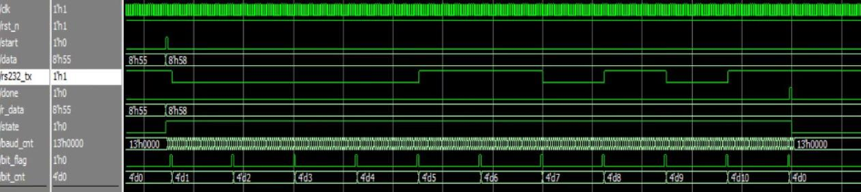
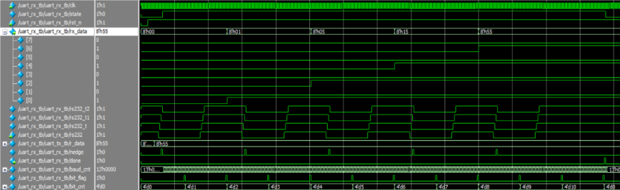

# Design and Implementation of UART using Verilog

A complete, self-contained implementation of a Universal Asynchronous Receiver-Transmitter (UART) core written in Verilog HDL. The project includes independent transmitter and receiver modules, an integrated top-level module, testbench simulation, and waveform verification results.

---

## Architecture Overview

UART is a serial communication protocol that transmits and receives data asynchronously without requiring a shared clock line between devices.

- **Frame Format**: 1 Start Bit (low) + 8 Data Bits (LSB first) + 1 Stop Bit (high)
- **Top Module**: `uart_top` integrates both transmitter (`uart_tx`) and receiver (`uart_rx`) to support full-duplex serial transmission.

```
                  +-----------------------------------+
                  |             uart_top              |
                  |                                   |
    data[7:0] --->|  +-----------+     +-----------+  |---> rx_data[7:0]
        start --->|  |  uart_tx  |     |  uart_rx  |  |---> rx_done
      tx_done <---|  |           |     |           |<---| rs232_in
     rs232_tx <---|  +-----------+     +-----------+  |
                  |         ^                ^        |
                  |         | clk, rst_n     |        |
                  +-----------------------------------+
```

---

## Detailed Module Descriptions

### 1. UART Transmitter (`src/uart_tx.v`)
- **Purpose**: Converts parallel 8-bit input data into a serial bitstream by prepending a start bit, transmitting 8 data bits (LSB-first), and appending a stop bit.
- **Operation**:
  - **State Machine**: Initiates transmission upon assertion of the `start` signal.
  - **Baud Rate Control**: Employs a baud counter (`baud_cnt`) configured to count 30 clock cycles per bit for simulation (configurable for standard physical baud rates such as 9600, 115200, etc.).
  - **Transmission Sequence**:
    - **Start Bit**: Drives `rs232_tx` low for one bit duration.
    - **Data Bits**: Transmits bits `[0]` through `[7]` sequentially on each bit interval.
    - **Stop Bit**: Returns `rs232_tx` high and asserts `done`.

### 2. UART Receiver (`src/uart_rx.v`)
- **Purpose**: Converts an incoming serial bitstream (`rs232`) into parallel 8-bit output data (`rx_data`).
- **Operation**:
  - **Synchronization**: Uses a 2-stage flip-flop synchronizer to mitigate metastability from asynchronous line transitions.
  - **Start Bit Detection**: Senses the falling edge denoting the beginning of a frame.
  - **Mid-Bit Sampling**: Samples data at the midpoint of each bit duration (baud count = 15) to maximize noise margins.
  - **Reception Sequence**:
    - Validates start bit and captures 8 data bits into parallel register `rx_data`.
    - Asserts `done` upon completion of frame reception.

### 3. Top-Level Module (`src/uart_top.v`)
- **Purpose**: Integrates the transmitter and receiver modules into a unified full-duplex communication interface.
- **Operation**:
  - Instantiates `uart_tx` and `uart_rx`.
  - Exposes parallel data buses, serial RX/TX lines, and completion status flags (`tx_done`, `rx_done`).

### 4. Testbench (`src/tb_uart.v`)
- **Purpose**: Simulates and validates the transmission and reception behavior.
- **Operation**:
  - Generates a 50 MHz clock signal (20 ns clock period).
  - Drives reset, stimulus byte (e.g., `8'h55`), and initiates transmission.
  - Monitors serial line activity and verifies received data.

---

## Simulation & Experimental Results

The design has been verified through simulation with the following waveform observations:

### UART Transmitter Simulation
The waveform demonstrates sequential framing: start bit (low), 8 data bits in LSB-first order, and final stop bit (high):



### UART Receiver Simulation
The receiver synchronizes with the incoming falling edge, samples each bit at midpoint, and registers the received byte with `rx_done` asserted:



---

## Directory Structure

```
├── docs/
│   └── images/
│       ├── rx_waveform.png
│       └── tx_waveform.png
├── src/
│   ├── tb_uart.v
│   ├── uart_rx.v
│   ├── uart_top.v
│   └── uart_tx.v
├── .gitignore
├── LICENSE
└── README.md
```
